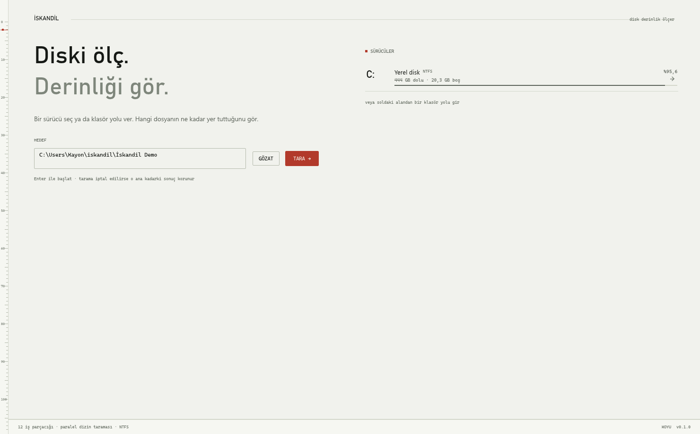
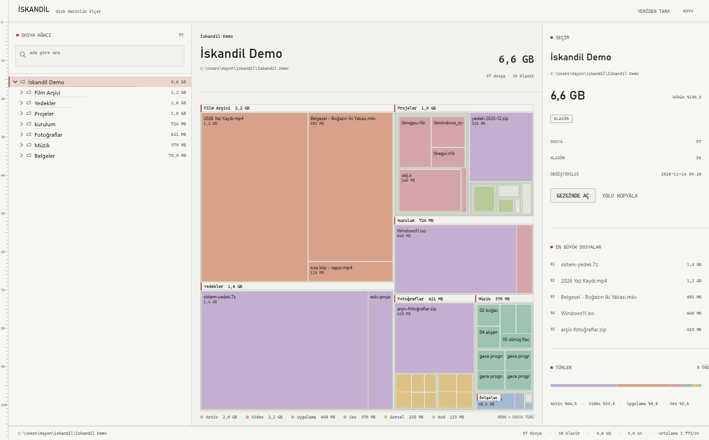
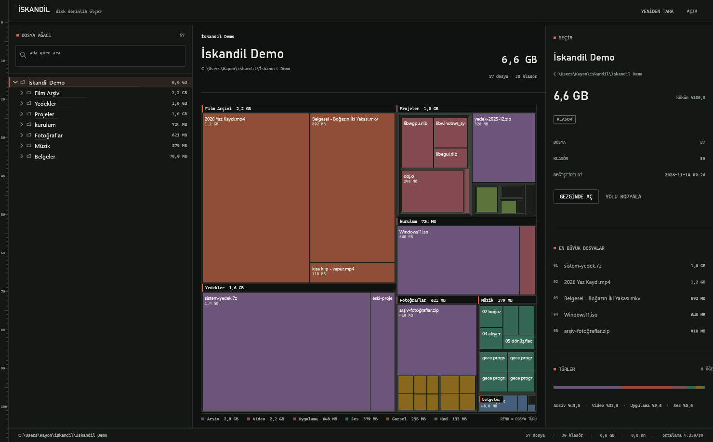
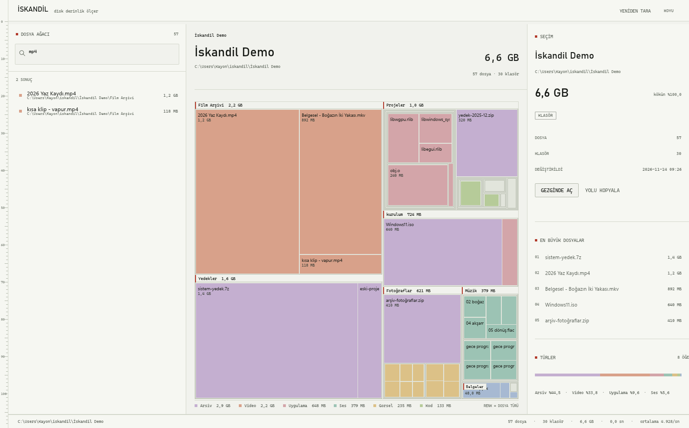
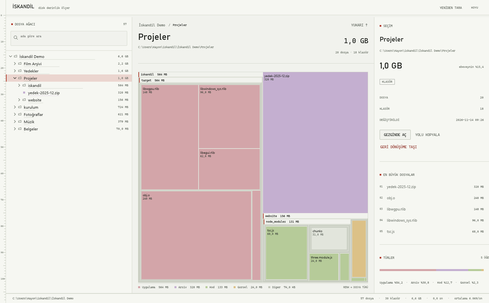
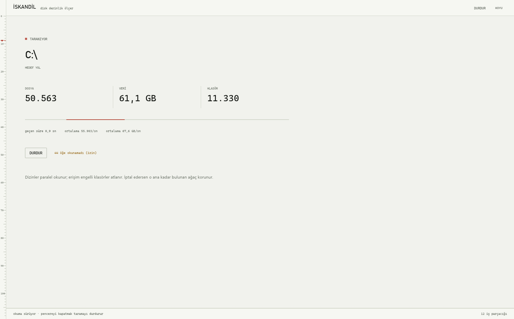
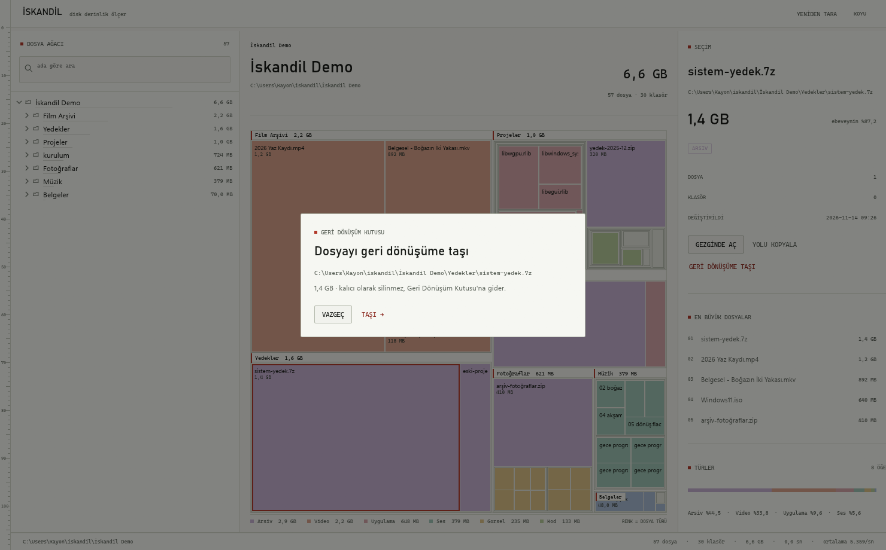

# İskandil

**Diskin derinliğini ölçen hızlı Windows alan gezgini.**

İskandil, bir sürücüyü veya klasörü paralel olarak tarar; hangi dosyanın ne kadar
yer tuttuğunu ağaç, treemap ve tür dağılımıyla gösterir. TreeSize/WinDirStat
işlevini Rust ile, sakin bir ölçüm aleti arayüzüyle yapar.

**Depo:** [github.com/ObsQrr/Iskandil](https://github.com/ObsQrr/Iskandil) · **Sürüm:** 0.1.0



## Neler yapar

- **Hızlı paralel tarama** — 12 iş parçacığı, `\\?\` uzun yol desteği, yeniden
  ayırma noktalarında döngü koruması, iptal edilebilir tarama (o ana kadarki
  sonuç korunur).
- **Treemap** — alanla orantılı, iç içe klasör başlıkları ve dosya türü renkleri.
  Bir klasöre çift tıklayarak derinleşin, breadcrumb ile geri dönün.
- **Dosya ağacı** — boyuta göre sıralı, sanallaştırılmış satırlar, satır içi pay
  çubukları, anlık arama.
- **Tür dağılımı** — video, görsel, ses, belge, kod, arşiv, uygulama ve diğer.
- **En büyük dosyalar** — seçili klasördeki en büyük 5 dosya, tıklayınca yerine gider.
- **Eylemler** — Gezgin'de göster, yolu kopyala, Geri Dönüşüm Kutusu'na taşı
  (onay diyaloğu ile; kalıcı silmez).
- **Açık/koyu tema** — grafik kâğıdı ve gece ölçümü.
- **Türkçe arayüz** — sayılar Türkçe biçimde (`1.284.032 dosya`, `%23,4`).



| Gece teması | Arama |
|---|---|
|  |  |

| Alt klasöre iniş | Tarama |
|---|---|
|  |  |



## Ölçülen hız

Aynı makinede (Ryzen 5 5500, NVMe, Windows 11), **release** derlemesi:

| Hedef | Dosya | Klasör | Boyut | Süre | Hız | Okunamayan |
|---|---:|---:|---:|---:|---:|---:|
| `C:\Windows\System32` | 24.301 | 1.631 | 8,98 GB | 0,26–0,55 sn | 44.000–93.000 dosya/sn | 18 |
| `C:\Users\Kayon` | ~1,49 M | ~278.500 | ~237 GB | 18,5–31,7 sn | 47.000–80.500 dosya/sn | 896 |

1,49 milyon girişlik taramada tepe çalışma kümesi **196,5 MB**. İlk (soğuk)
taramada disk metadata'sı önbellekte olmadığı için süre daha yüksektir; aynı
ağaçtaki ikinci tarama belirgin biçimde hızlanır. Profil taramasında dosya
sayısı taramalar arasında değişebilir (geçici dosyalar/derleme çıktıları).

İskandil **NTFS MFT'sini okumaz**; bunun yerine paralel dizin taraması kullanır.
MFT tabanlı araçlar (WizTree gibi) yerel NTFS'te daha hızlı olabilir; İskandil
yönetici hakkı istemez ve ağ/çıkarılabilir birimlerde de aynı yolu kullanır.

## Kurulum

Kurulum gerekmez; tek EXE.

1. [Releases](https://github.com/ObsQrr/Iskandil/releases) sayfasından
   `iskandil-0.1.0-win-x64.zip` dosyasını indirin.
2. Arşivi bir klasöre açın ve `iskandil.exe` dosyasını çalıştırın.
3. Bir sürücü seçin veya `C:\Users\...` gibi bir yol yazın.

İlk çalıştırmada pencere 1460×920 açılır. Son yol ve tema
`%APPDATA%\Iskandil\settings.json` içinde saklanır.

### Kaynaktan

```powershell
cargo build --release -p iskandil-app
.\target\release\iskandil.exe
```

Gereksinim: Rust 1.86+ ve MSVC araç zinciri. Release paketleme için
`scripts\build-release.ps1` (statik CRT, ICO kaynağı, zip) → `dist\iskandil\iskandil.exe`.

## Komut satırı

```
iskandil [YOL]
  --scan YOL       Taramayı hemen başlat
  --view YOL       Tarama sonrası bu alt klasöre gir
  --search METİN   Tarama sonrası aramayı doldur
  --theme light|dark
  --size 1460x920
  --bench YOL      Arayüz olmadan tara, ölçümleri yazdır
  --shot PNG       Ekran görüntüsü kaydet ve çık (geliştirme)
  --shot-now       Tarama bitmeden ekran görüntüsü al
  --ask-delete-largest  En büyük dosyanın silme onayını aç (QA)
```

Örnekler:

```powershell
iskandil C:\
iskandil --scan "C:\Users\Kayon\Downloads" --view "kurulum" --theme dark
iskandil --bench C:\Windows\System32
```

## Kısayollar

| Tuş | Eylem |
|---|---|
| `F5` | Yeniden tara |
| `Esc` | İptal / aramayı temizle / bir üst klasör |
| `Enter` | Seçili klasöre gir |
| `Alt+↑` | Bir üst klasör |
| `Ctrl+F` | Aramaya odaklan |
| Çift tık | Treemap'te klasörün içine gir |

## Mimari

```
crates/core     taranmış ağaç, paralel tarayıcı, treemap geometrisi, biçimlendirme
crates/app      egui/eframe arayüzü, tema, paneller, eylemler
```

- `iskandil-core` UI'dan bağımsızdır ve 32 birim testi vardır (tarama, toplamlar,
  treemap yerleşimi, Türkçe biçimlendirme, arama). Geri Dönüşüm Kutusu testi
  varsayılan olarak kapalıdır (`--ignored`).
- Tarama: klasör başına iş kuyruğu, `Mutex` + `Condvar`, klasör başına tek arena
  kilidi; toplamlar tarama sonunda tersten tek geçişte hesaplanır.
- Treemap: squarified algoritma; 4.000 döşeme ve 240 çocuk sınırı, taşan öğeler
  tek bir "N öğe" kutusunda toplanır.
- Arayüz: `eframe`/`egui` 0.37 + wgpu. Sistem fontları (Bahnschrift, Cascadia Mono,
  Segoe UI Variable) çalışma anında yüklenir; gömülü font dosyası yoktur.

## Tasarım notu

Tasarım okuması: *güç kullanıcıları için bir Windows ölçüm aleti; deniz haritası /
sörvey dili; grafik kâğıdı zemin, mürekkep tipografi, tek vermilyon vurgu.*

- Zemin: `#F1F2ED` grafik kâğıdı; mürekkep `#161915`; tek vurgu `#B23A2B`.
- Paneller ve döşemeler köşesiz; yalnızca etkileşimli kontrollerde 2 px yarıçap.
- Başlık/rakam Bahnschrift, etiket ve veri Cascadia Mono, gövde Segoe UI Variable.
- Sol kenardaki 18 px'lik derinlik cetveli uygulamanın kimlik omurgasıdır.
- Mor gradyan, cam efekti, yuvarlak kart yığını yok; hiyerarşi hairline ve
  tipografiyle kurulur.

Renkler dosya türüne göredir ve tema başına ayrı bir eşleme kullanır. Dosya
döşemelerinde metin her iki temada da okunur.

## Bilinen sınırlar

- MFT tabanlı tarama yok; büyük NTFS birimlerinde WizTree kadar hızlı değildir.
- Yönetici olarak çalıştırılmazsa korumalı klasörler atlanır; durum çubuğunda
  "N okunamadı" olarak görünür.
- Fiziksel silme yoktur; yalnızca Geri Dönüşüm Kutusu'na taşır. Geri alınamayan
  eylemler için Windows'un kendi onayı kullanılmaz, uygulama kendi onayını gösterir.
- Aynı anda tek tarama; önceki tarama sonucu yeni tarama bitene kadar korunur.
- PDF/CSV dışa aktarma, yinelenen dosya bulucu, anlık görüntü karşılaştırması,
  zamanlanmış tarama yoktur.
- Bağlantı noktalarının (junction/symlink) içine girilmez; 0 bayt olarak görünür.
- Treemap 4.000 döşemeyle sınırlıdır; çok büyük klasörlerde temsilidir.
- Tek monitörde test edildi; imzalı EXE/installer yoktur.

## Lisans

MIT — bkz. [LICENSE](LICENSE).

Treemap, dosya ağacı ve tür dağılımı fikirleri TreeSize/WinDirStat araçlarından
ilham alır; kod, metin ve görsel dil bu projeye özgüdür.
